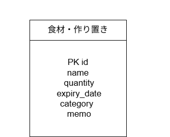
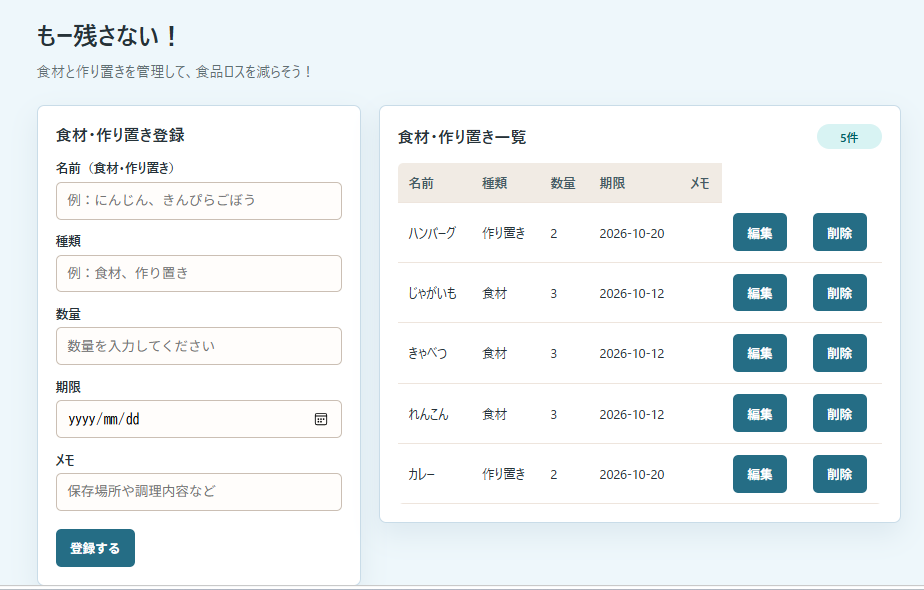

# もー残さない！


食材や作り置きの期限を管理して、食品ロスを減らすためのアプリです。


## ▏アプリケーションの概要


「もー残さない！」は、食材や作り置きの情報を登録・管理するアプリです。


食材の名前、カテゴリー、数量、期限、メモを登録し、一覧で確認できます。

登録した情報は、編集・削除することもできます。


## ▏開発した背景・理由


食材を購入しても、期限を忘れて使い切れないことがあるため、食材や作り置きの期限を管理できるアプリを制作しました。


食材の情報を一覧で確認できるようにすることで、期限の確認や使い忘れの防止につなげ、食品ロスを減らすことを目指しています。


## ▏主な機能


* 食材・作り置きの登録

* 登録した食材の一覧表示

* 登録内容の編集

* 登録内容の削除


## ▏使用技術


### フロントエンド


* HTML

* JavaScript


### バックエンド


* Java 21

* Spring Boot


### データベース


* MySQL 8.4


### 開発環境


* IntelliJ IDEA

* Docker Desktop


## ▏データベース設計（ER図）





## ▏アプリケーションの画面





## ▏ローカル環境での起動方法


### 必要な環境


* Java 21

* Docker Desktop


### 起動手順


1. Docker Desktopを起動します。


2. プロジェクトのルートフォルダで、データベースを起動します。


&#x20;  ```bash

&#x20;  docker compose up -d

&#x20;  ```


3. IntelliJ IDEAでプロジェクトを開き、Spring Bootのメインクラス `Application.java` を実行します。


4. ブラウザで次のURLにアクセスします。


&#x20;  `http://localhost:8081/index.html`


